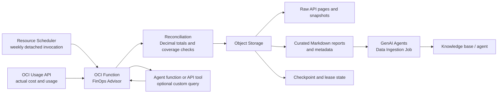

# OCI FinOps Advisor function — v0.2.0

An OCI Functions reference implementation that collects Usage API cost data, creates reconciled reports in Object Storage, and can optionally submit a Generative AI Agents ingestion job. Configure all tenancy-specific values at the function level; no tenancy, bucket, namespace, or resource identifiers are included in this repository.

A replacement for `weekly-cost-rag`: collect historical OCI Usage API data, retain an incremental archive, publish calculated Markdown reports to Object Storage, then optionally submit a Generative AI Agents ingestion job.

## Architecture flow



The function uses its OCI resource principal. Configure IAM for Usage API read access, Object Storage access, and—only when ingestion is enabled—Generative AI Agents ingestion access. Tenancy-specific identifiers belong in `config.json` or function configuration and are intentionally excluded from this repository.

**Default: one year of historical data.** Set `HISTORY_YEARS=2` before the first run to request two years. Oracle's Cost Analysis documentation notes historical availability of up to twelve months; do not assume two years are available in your tenancy. The function does not invent missing records or silently shorten an API-rejected interval. Successful empty windows are explicitly disclosed in coverage reports. Previously retained cost reports would need a separate import adapter if the API cannot supply older history.

## Files

- `function/func.py`: entrypoint, checkpointing, collection, publication, ingestion and query action.
- `function/analytics.py`: Decimal arithmetic, reconciliation, reports and custom queries.
- `function/insights.py`: annual comparisons, normalized rates, concentration, weekday/weekend patterns and service-specific investigations.
- `function/optimization_playbook.txt`: grounded reasoning guidance ingested with the reports.
- `function/func.yaml`, `function/requirements.txt`: Python 3.11 deployment configuration and pinned SDK/FDK.
- `config.example.json`: configuration template; replace placeholder values.
- `apply_config.py`: apply a completed JSON configuration using the Fn CLI.
- `agent-instructions.txt`: paste into the agent's instructions.
- `query-examples.json`: example invocation payloads. Replace dates/IDs with values within your published coverage.
- `query-tool-schema.json`: optional query action input schema, not an automatically registered agent tool.
- `function/tests/`: offline arithmetic, recovery, storage concurrency and real-SDK parameter tests.

## Required configuration

| Variable | Meaning |
|---|---|
| `NAMESPACE` | Your Object Storage namespace. Required. |
| `BUCKET_NAME` | Bucket used for reports, checkpoints, and raw snapshots. Required. |
| `TENANCY_OCID` | Full tenancy OCID whose costs are queried. |
| `OCI_REGION` | Function, Usage API, and Object Storage region. Required. |
| `COMPARTMENT_ID` | Compartment for ingestion jobs; required when ingestion is enabled. |
| `DATA_SOURCE_ID` | Existing GenAI Agents Object Storage data source; required when ingestion is enabled. |

Use full OCIDs, not the shortened examples in the conversation. Authentication uses the function's resource principal; no private key is needed.

## Tunable configuration

| Variable | Default | Purpose |
|---|---:|---|
| `HISTORY_YEARS` | `1` | Initial lookback: `1` or `2`; choose before creating state. |
| `RUN_INGESTION` | `false` | Keep false until reports have been validated; later change to true. |
| `INCLUDE_USAGE` | `true` | Also collect quantities by compartment/service/SKU/unit. |
| `GENAI_REGION` | OCI_REGION | Region containing the agent data source. |
| `RAW_PREFIX` | `cost-analysis/raw` | API pages and immutable normalized snapshots. |
| `CURATED_PREFIX` | `cost-analysis/curated` | Markdown reports and metadata sidecars. |
| `STATE_PREFIX` | `cost-analysis/state` | Checkpoint and concurrency lease. |
| `CHUNK_DAYS` | `7` | Historical/refresh request window; 1–31 days. |
| `REVISION_LOOKBACK_DAYS` | `35` | Re-fetch recent days on every new refresh to capture revisions. |
| `DATA_LAG_DAYS` | `2` | UTC cutoff lag; today's date minus this value is exclusive. |
| `COMPARTMENT_DEPTH` | `6` | Usage API compartment depth. Match it in Cost Analysis. |
| `MAX_RUNTIME_SECONDS` | `3000` | Soft execution budget; reserve time to return before the platform deadline. |
| `API_READ_TIMEOUT_SECONDS` | `120` | Per-request read timeout; connection timeout is 10 seconds. |
| `MAX_WINDOW_ROWS` | `200000` | Maximum normalized rows combined in a single request window. |
| `MAX_OBJECT_MB` | `128` | Maximum encoded or expanded JSON object size. |

The previous `DETAIL_GROUP_BY`, `ANALYSIS_DAYS`, `WEEKLY_REFRESH_DAYS`, and `KNOWLEDGE_BASE_ID` are unused. Fixed query views respect the four-dimension limit and avoid mixed-currency/unit sums. The data source already identifies the knowledge base. Resource Scheduler controls the weekly schedule; an environment variable does not schedule invocations.

## Collection and arithmetic

Four paginated daily queries are made for each window:

| View | Query type | Grouping |
|---|---|---|
| Compartment/service costs | COST | compartmentId, compartmentPath, service, currency |
| Regional costs | COST | compartmentId, service, region, currency |
| Independent reference total | COST | currency |
| Physical usage (optional) | USAGE_ONLY | compartmentId, service, skuPartNumber, unit |

Both cost breakdowns must match the reference by date and currency within max(0.01 currency units, 0.000001 × absolute reference amount). A mismatch prevents committing that window and publishing/ingesting the cycle. Retried queries may be needed if Oracle revised data between the separate requests.

Amounts are summed with Decimal from SDK-returned values, then rounded for display. Forecast rows are excluded. Missing `computed_amount`, currency, quantity or unit is an error; attributed cost is never substituted. The regional and compartment views describe the same money and are never added together. Usage rankings are partitioned by service, SKU and unit.

Compartment results follow the configured API depth. A compartment at the selected boundary may include deeper descendants. There is no additional local hierarchy expansion, and historic paths may change for a stable compartment ID.

## Deployment

Use your existing OCI Functions development environment with Docker, Fn CLI, OCI CLI, the correct Fn context and OCIR authentication. Nothing in this package deploys itself.

1. Before a clean slate, disable the old schedule to avoid the old function repopulating the bucket. Use dedicated prefixes or a dedicated bucket. Do not delete unrelated objects. Verify the existing knowledge base does not continue returning old indexed documents after the new ingestion; clearing a bucket is not a verification of index cleanup.
2. Copy `config.example.json` to `config.json` and fill in the full values. Choose `HISTORY_YEARS` and keep `RUN_INGESTION=false`.
3. From the package root, deploy:

   ```sh
   cd function
   fn deploy --app cost-analysis-app
   cd ..
   python3 apply_config.py --app cost-analysis-app --function weekly-cost-rag --config config.json
   ```

4. Configure **Detached invocation timeout = 3600 seconds** in the function console. The supplied `timeout: 300` is for synchronous invocations and does not set detached timeout. Alternatively:

   ```sh
   oci fn function update --function-id '<FUNCTION_OCID>' \
     --detached-mode-timeout-in-seconds 3600
   ```

   The initial memory setting is 1024 MB. Observe memory/runtime and adjust using real workload measurements. After each redeployment, verify the detached timeout is still set.

5. Enable function application logs. Set the GenAI data source's Object Storage scope to **`cost-analysis/curated/`**, not the bucket root. The function maintains a root `_metadata_schema.json`, merging its own fields without deleting other schema fields. Raw/state files must not be ingested. Avoid separate/manual ingestion while this function is publishing.
6. Run the initial backfill in detached mode:

   ```sh
   oci fn function invoke --function-id '<FUNCTION_OCID>' \
     --fn-invoke-type detached --body '{"action":"refresh"}' --file -
   ```

   Detached invocation acceptance is not completion. Inspect the final `invocation_result` log or call the fast status action:

   ```sh
   oci fn function invoke --function-id '<FUNCTION_OCID>' \
     --body '{"action":"status"}' --file - --read-timeout 320
   ```

7. If the result is `resume_required`, invoke refresh again. **Continuation is resumable, not self-scheduled.** During initialization, manually continue or use a temporary hourly Resource Scheduler schedule until collection completes. Long backfills can require several invocations. The lock prevents concurrent refreshes. Do not wait a week between unfinished backfill invocations.
8. Validate the coverage reports and selected totals against Cost Analysis (see below). Enable ingestion:

   ```sh
   fn config function cost-analysis-app weekly-cost-rag RUN_INGESTION true
   ```

   Invoke refresh again. It submits ingestion for the already-published report set before starting a newer cycle. Subsequent refresh invocations check the saved job. No polling loop consumes function time. `ingestion_submitted` is not proof that chat data is ready; wait for `SUCCEEDED` and inspect file statistics/logs.
9. Configure Resource Scheduler weekly in your chosen timezone. Leave the invocation payload empty or use `{"action":"refresh"}`. A new cycle refreshes the correction lookback and every missing date through its cutoff. It catches up after missed schedules. The initial history start remains fixed and the archive grows; no raw-data retention/deletion policy is applied automatically.

## IAM and networking

Adapt these templates to your identity domain and compartments. The function dynamic group should match this function, for example:

```text
ALL {resource.type='fnfunc', resource.id='<FUNCTION_OCID>'}
```

Function policies:

```text
Allow dynamic-group <FUNCTION_DG> to read usage-report in tenancy
Allow dynamic-group <FUNCTION_DG> to manage objects in compartment <BUCKET_COMPARTMENT> where target.bucket.name='<BUCKET_NAME>'
Allow dynamic-group <FUNCTION_DG> to manage genai-agent-family in compartment <AGENT_COMPARTMENT>
```

The objects policy permits checkpoint conditional writes, reading snapshots, creating/overwriting reports and deleting stale generated reports/locks. No bucket creation is performed. GenAI permissions are unnecessary while `RUN_INGESTION=false`.

Also configure ingestion-job access to the bucket using Oracle's documented resource principal pattern:

```text
ALL {resource.type='genaiagentdataingestionjob', resource.compartment.id='<AGENT_COMPARTMENT_OCID>'}
Allow dynamic-group <INGESTION_DG> to read objects in compartment <BUCKET_COMPARTMENT> where target.bucket.name='<BUCKET_NAME>'
```

The Resource Scheduler resource needs its own permission to invoke the function. Follow Oracle's scheduling guide. Ensure the function subnet can resolve and reach HTTPS endpoints for Usage API, Object Storage, and the selected GenAI region through appropriate service/NAT gateway routes and egress rules. In particular, a service gateway route for one region alone may not cover a different GenAI region. A networking failure is not repaired by increasing a timeout.

## Generated analysis

Calculated reports cover 7, 14, 21, 28, 30, 60 and 90 days; trailing 1, 3, 6, 12 and 24 calendar months; month/quarter/year to date; previous calendar year; each archived calendar month and completed quarter; and the previous completed Monday–Sunday week, month and quarter. An interval lacking queried days produces a coverage-only report, not a partial total labeled as complete.

Per available period: cost and daily average by currency, compartment/service rankings and shares, services within each compartment, regional service costs, daily costs, largest increases/decreases, spike candidates (more than 50% above the preceding seven calendar days), usage by compartment/service/SKU/unit, and a simple 30-day run-rate scenario. All ranking rows are split into small report sections rather than dropping everything below top 10. Prior-period comparisons are disabled when prior coverage is missing or unverified. Year-over-year comparisons use the same calendar interval shifted back twelve months, when fully covered. Additional reports show daily-rate changes, positive service-spend concentration, negative service subtotals, appearing/disappearing nonzero service spend, UTC weekday/weekend patterns, and investigations prioritized by observed service cost. No prior two-year comparison is possible from only two years of data.

Measured service-specific investigation reports and the generic optimization playbook are ingested alongside the financial reports. Paste `agent-instructions.txt` into the agent. This code does not call an LLM to fabricate explanations or savings. Actual rightsizing, idleness, budgets, contracts, tags, invoice reconciliation, pricing attribution and business unit economics require additional inputs and are not implemented here.

## Custom queries

The `query` action calculates from the last fully published snapshot. It uses the old published manifest while a refresh is collecting newer data, so partially collected revisions do not leak into queries. It does not read live Cost Analysis.

Example:

```json
{"action":"query","metric":"cost","start_date":"2026-07-01","end_date":"2026-09-29","group_by":["service"],"filters":{"compartment_id":"<COMPARTMENT_OCID>"},"limit":20}
```

Use full UTC dates with an exclusive end inside published coverage. Cost supports currency, date, compartment_id, service, and either region or compartment_path. You cannot combine region and path in one query. Usage supports date, compartment_id, service, sku_part_number and unit. Filters are exact scalar matches; automatic descendant expansion is not supported. `limit` is 1–1000 groups per currency or service/SKU/unit partition. Monetary and quantity values are decimal strings. Set `order` to `ascending` for bottom N or `descending` (default) for top N. Each partition returns `total_value_all_groups`, computed before limiting the rows, so a top-N result is not mistaken for the full total. Group by currency alone for cost totals.

To expose this in GenAI chat, separately register a function/API tool that invokes this action using the supplied schema. **Deployment alone does not connect the query action to the agent.** Large custom queries can exceed an interactive tool's time budget because archived snapshots must be loaded. Start with smaller ranges, or put the structured data in an indexed database for frequent interactive multi-year queries. Synchronous invocations respect the platform deadline and can return `resume_required`; read-only queries do not save a query cursor and must be rerun with a narrower range or larger appropriate invocation budget. Markdown RAG supports the precomputed periods without this tool.

## Validation against Cost Analysis

Compare a completed named interval with the same UTC dates, COST/actual setting, tenancy, currency, compartment depth and filters, with forecast and cumulative presentation disabled. Compare the console's downloadable data, not rounded chart labels. Console data refreshed after collection can differ due to revisions. Data availability can lag by up to 48 hours; this implementation uses a conservative two-day cutoff. Corrections older than `REVISION_LOOKBACK_DAYS` are not automatically re-fetched; temporarily increase that value and force a refresh if needed.

The API reference-total comparison is internal reconciliation. It is not a live-console or invoice certification. Empty history is explicitly flagged, because no returned records may indicate an unavailable interval or no activity. Confirm coverage before reporting a year total as complete.

## Recovery and statuses

- `resume_required`: refresh again; page/report checkpoints are durable. There is no self-invocation.
- `busy`: another refresh holds the lease. Wait for it to finish; abandoned leases expire after 62 minutes. Do not delete a live lock.
- API/authorization/network error: fix the cause and invoke refresh again. Errors are logged with traceback and raised, not returned as success. SDK automatic retries are disabled to bound execution; the next invocation resumes safely.
- Reconciliation failure: inspect retained API pages, then invoke `{"action":"restart_window"}` followed by refresh to re-fetch the uncommitted window. No published history is cleared.
- Window too large: lower `CHUNK_DAYS`, invoke `restart_window`, then refresh. Raise memory/limits only after measuring the workload.
- Expired/invalid pagination token: use `restart_window` and refresh.
- `ingestion_submitted` / `ingestion_in_progress`: refresh again to check the job. Collection waits until the saved job completes, so reports are not changed during ingestion.
- `ingestion_failed`: inspect job logs; fix IAM, format or data-source issues, then invoke `{"action":"retry_ingestion"}`. File-level failed counts are treated as failure even when the lifecycle says SUCCEEDED. Review ignored-file counts too.
- `collection_complete` with ingestion disabled: reports are published, but the agent has not been updated. Enable ingestion and refresh.
- Changing report version, tenancy, collection region, history years, usage inclusion, compartment depth or dataset prefixes after initialization is rejected to prevent mixing incompatible records. Use a fresh dedicated set of prefixes/bucket for a new dataset. Changing the GenAI data source after ingestion requires a forced refresh to publish a new generation for that source.

Report uploads use stable, readable filenames with a short collision-resistant suffix, and stale reports from previous published generations are deleted only after new uploads finish. Only then is the published manifest committed and ingestion eligible. Object Storage multi-object publication and GenAI indexing are not transactional: do not run a separate ingestion against this prefix while publication is in progress. Protect the archive/state with normal backup/versioning practices; this package does not create bucket policies or delete raw history.

## Tests and deployment limits

```sh
cd function
python3 -m venv .venv
. .venv/bin/activate
pip install -r requirements.txt
python -m unittest discover -s tests -v
```

Tests run locally with synthetic responses and the pinned OCI SDK. They exercise dates, Decimal arithmetic, pagination recovery, revisions, coverage, publication interruption, ingestion response loss and partial failure, conditional locks and SDK keyword/model compatibility. A live OCI invocation, image build, IAM, endpoint reachability, tenancy history availability and live-console reconciliation must be verified in your environment.

## Oracle references

- [Cost Analysis dates, grouping, availability and IAM](https://docs.oracle.com/en-us/iaas/Content/Billing/Concepts/costanalysisoverview.htm)
- [Usage API Python SDK](https://docs.oracle.com/en-us/iaas/tools/python/latest/api/usage_api/client/oci.usage_api.UsageapiClient.html)
- [Function timeout settings](https://docs.oracle.com/en-us/iaas/Content/Functions/Tasks/functionscustomizing.htm)
- [Resource Scheduler detached invocations](https://docs.oracle.com/en-us/iaas/Content/Functions/Tasks/functionsschedulingfunctions-about.htm)
- [Python FDK images](https://docs.oracle.com/en-us/iaas/Content/Functions/Tasks/functionssupportedlanguageversions.htm)
- [GenAI ingestion IAM](https://docs.oracle.com/en-us/iaas/Content/generative-ai-agents/iam-policies.htm)
- [Markdown and metadata requirements](https://docs.oracle.com/en-us/iaas/Content/generative-ai-agents/RAG-tool-object-storage-guidelines.htm)

## Bucket folder structure

No console folders need to be created in advance; object prefixes form this layout. Filenames below show the naming pattern; the hexadecimal suffix varies.

```text
<BUCKET_NAME>/
├── _metadata_schema.json
└── cost-analysis/
    ├── curated/                      # GenAI data-source prefix
    │   ├── catalog.md
    │   ├── optimization_playbook.md
    │   └── reports/
    │       ├── last_7_days/
    │       ├── last_21_days/
    │       ├── last_3_months/
    │       │   ├── usd_overview-<id>.md
    │       │   ├── usd_services_0-<id>.md
    │       │   ├── usd_compartments_0-<id>.md
    │       │   ├── usd_optimization_reviews-<id>.md
    │       │   └── <each file>.md.metadata.json
    │       ├── last_12_months/
    │       ├── previous_calendar_quarter/
    │       └── calendar_2026_Q3/      # Example historical period
    ├── raw/
    │   ├── api-pages/<cycle-id>/<window-start>/<view>/
    │   └── snapshots/<cycle-id>/
    └── state/
        ├── checkpoint.json
        └── lock.json                # Present only while a run owns the lease
```

Configure the new GenAI data source for this bucket and `cost-analysis/curated/`. An old `DATA_SOURCE_ID` that still points at the previous bucket will not ingest this new bucket. Use a new checkpoint for this replacement; v0.1 state is intentionally incompatible with the expanded v0.2 report plan.
